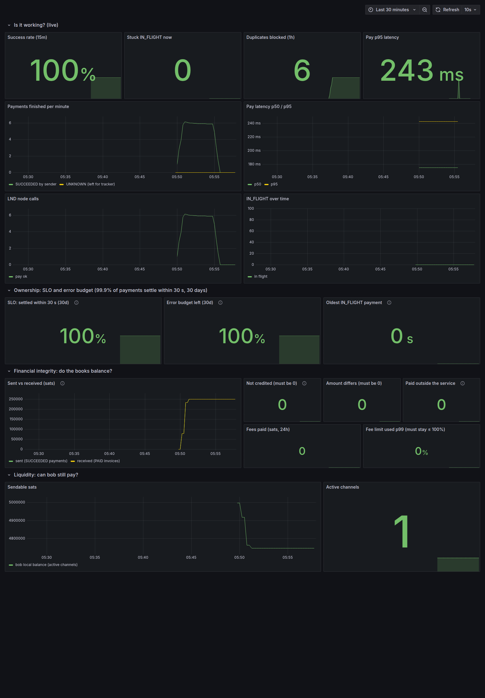
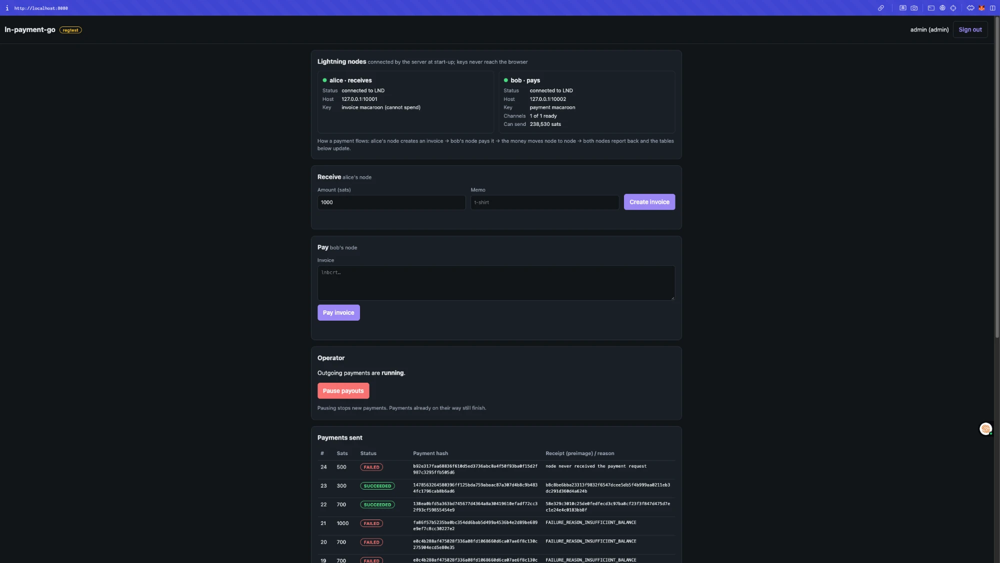

# Lightning Payments Service

## Monitoring: Prometheus and Grafana on a real regtest run

Run on 13 Nov 2026: bitcoind and two LND nodes started by `scripts/regtest-local.sh`, 30 payments from bob to alice through the API, and 6 double-pay attempts. Prometheus scraped the service every 5 seconds and Grafana drew the dashboard.

| What | Result |
|---|---|
| Payments | 30 of 30 SUCCEEDED, p95 time for the Pay call about 240 ms |
| Double payments | 6 attempts, 6 refused with 409 |
| Books | 250,000 sats sent = 250,000 received; 0 not credited, 0 amount differences |
| Liquidity | bob's sendable balance fell from 5.0M to 4.75M sats |
| Alerts | all 5 rules loaded, none firing |





A small Go service that sits next to two Lightning (LND) nodes: one receives ("alice"), one pays ("bob").
It creates invoices, pays invoices, and keeps a correct record of every payment, including when things fail.

Status: works end to end on regtest. Real payments between two LND nodes, and the failure cases in the test report, have been run by hand. Automated tests for those cases are still to be written.

## Design rules

- The node is the truth about money; the database holds the business record.
- Save the payment row (with the payment hash from the invoice) before telling the node to pay.
- The database refuses a second live payment for the same hash (partial unique index). No check-then-insert.
- An error from the node call means "unknown", never "failed". The row stays IN_FLIGHT.
- The tracker asks the node what happened; it never pays again. Only the node's final answer closes a payment.

## Layout

| Path | What |
|---|---|
| `migrations/001_payments.sql` | payments table and its rules |
| `internal/payment` | status values and allowed moves |
| `internal/store` | all Postgres access |
| `internal/httpapi` | the HTTP endpoints, sign-in and roles |
| `internal/web` | the browser pages |
| `internal/lnd` | all calls to the nodes; local invoice decoding |
| `cmd/server` | the program: API plus workers |
| `internal/worker` | sender, tracker, invoice listener |

## How to run it

Everything runs on your own machine with play money (Bitcoin "regtest"). No real funds are involved.

### What you need

| Tool | Why | Check |
|---|---|---|
| [Go](https://go.dev/dl/) 1.23 or newer | builds and runs the server | `go version` |
| [Docker Desktop](https://www.docker.com/products/docker-desktop/) | runs the Lightning nodes and the database | `docker ps` |
| [Polar](https://lightningpolar.com/) | starts a private Lightning network in Docker | open the app |

### Step 1: create the Lightning network in Polar

1. Open Polar and click **Create Network**. Choose **2 LND nodes** and **1 Bitcoin Core node**. Polar names the nodes `alice` and `bob`.
2. Click **Start** and wait until all three nodes are green.
3. Give bob money: click **bob**, then **Actions**, then **Deposit** (1,000,000 sats is plenty).
4. Open a channel from bob to alice: drag from bob to alice (or **bob → Actions → Open Channel → Outgoing**), capacity 250,000 sats.
5. Click the Bitcoin node, then **Actions → Quick Mine**, and turn on **Auto Mine (30s)**. LND only works while new blocks keep arriving.

### Step 2: get the code and start the server

```bash
git clone https://github.com/rupeshkoushik07/lightning-payments-service.git
```

```bash
cd lightning-payments-service
```

```bash
scripts/run-polar.sh
```

The script does three things: turns on demo sign-in, starts a PostgreSQL container named `lnpay-pg` on port 55432, and runs the server pointed at alice and bob. The database tables are created automatically on first start.

If your Polar network is not number 1, pass its number: `POLAR_NET=2 scripts/run-polar.sh`.

### Step 3: sign in and make a payment

Open http://localhost:8080. The sign-in page shows one button per demo user; click one to enter. There are no passwords to set up and none in this repository.

| User | Can do |
|---|---|
| `alice` | create invoices (receive) |
| `bob` | pay invoices |
| `admin` | both, plus the pause switch |

1. In one browser window, click **alice (receiver)** and create an invoice for 1,000 sats. Copy the invoice text (it starts with `lnbcrt`).
2. In a private window, click **bob (payer)**, paste the invoice and click **Pay**.
3. Watch both tables: bob's payment goes PENDING → IN_FLIGHT → SUCCEEDED, and alice's invoice goes OPEN → PAID. In Polar, the channel balance moves by 1,000 sats.

### About demo sign-in

Demo sign-in (`DEMO_LOGIN=true`) skips the password only. Everything after it is the real thing: a random session token in an HttpOnly cookie, a role checked on every route (bob cannot create invoices, alice cannot pay), and the same-origin check. The server refuses to start in demo mode unless it listens on this machine only (`127.0.0.1` or `localhost`), so the buttons cannot be reached from the network.

Without `DEMO_LOGIN`, the buttons do not exist and the server uses password sign-in: set `ALICE_PASSWORD`, `BOB_PASSWORD` and `ADMIN_PASSWORD` in the environment (at least 8 characters each); only their bcrypt hashes are stored.

### Stop and clean up

Press `Ctrl+C` in the terminal to stop the server (it finishes in-flight work first). To remove the database:

```bash
docker rm -f lnpay-pg
```

### If something does not work

| What you see | Cause | Fix |
|---|---|---|
| Node panel shows a red dot | Polar network is not started, or a different network number | Start the network in Polar; use `POLAR_NET=<number>` |
| "Channels: 0 of 1 ready", payments fail with insufficient balance | LND is waiting for a recent block | In Polar: Bitcoin node → Quick Mine, and turn on Auto Mine |
| `no such file ... tls.cert` | Polar keeps its files somewhere else, or the nodes have other names | Check `~/.polar/networks/<number>/volumes/lnd/` has `alice` and `bob` |
| `address already in use` | Port 8080 or 55432 is taken | `LISTEN_ADDR=127.0.0.1:8090 scripts/run-polar.sh`, or stop the other program |
| No demo buttons, a password form instead | The server was started without `DEMO_LOGIN=true` | Start it with `scripts/run-polar.sh` |

### Run the tests only

No Lightning nodes needed:

```bash
go test ./...
```

### API

| Endpoint | Who | Does |
|---|---|---|
| `POST /api/login`, `POST /api/logout`, `GET /api/me` | anyone | session sign-in |
| `POST /api/invoices` | receiver, admin | create an invoice on alice |
| `GET /api/invoices`, `GET /api/invoices/{hash}` | signed in | OPEN, PAID or EXPIRED |
| `POST /api/payments` | payer, admin | accept an invoice to pay from bob; answers 202 |
| `GET /api/payments`, `GET /api/payments/{id}` | signed in | PENDING, IN_FLIGHT, SUCCEEDED (with preimage) or FAILED |
| `GET/POST /api/admin/payouts` | admin | read or flip the pause switch |

## How it was tested

The happy path is the easy part of a payment system. Most of the work here went into deciding what must happen when something breaks, and then breaking it on purpose to check. Full details, numbers and screenshots are in [docs/test-report.md](docs/test-report.md).

### 1. Breaking it on purpose, on real nodes

Run by hand through the web page against two LND nodes on regtest.

| Test | What was done | How it fails | What the service does |
|---|---|---|---|
| A. Pay twice | paid the same invoice again | a second payment would double-pay the receiver | refuses: "already being paid or was paid"; one row only |
| B. Paying node down | stopped bob's node, then asked to pay | the call to the node errors; nobody knows if it paid | accepts and holds the payment as `IN_FLIGHT` (not `FAILED`); when the node returns, asks it, and closes the payment with the node's answer |
| C. Pause switch | paused payouts, tried to pay, restarted the service | an operator needs to stop money leaving, now | refuses new payments; invoices still work; still paused after a restart |
| D. Receiver paid while we are down | stopped the service, paid alice directly from bob, started it again | the "invoice paid" message arrives when nobody is listening | on start-up asks the node for everything after its saved place; the invoice turns `PAID` |
| E. Crash mid-payment | `kill -9` on the service with a payment unresolved | the program dies with no chance to clean up | the row was saved before the node was called, so it survives; the tracker settles it after restart; a retry succeeds once |
| F. Bad input, wrong account | rubbish text, a 200,000-sat request, a genuine but oversized invoice, the wrong role | invalid or unwanted requests reach the database or the node | refuses each before saving anything or calling a node |

Invoice expiry was also observed: unpaid invoices from the test session were marked `EXPIRED` by the background job.

One real incident came out of test B. After the node restarted, payments failed with "insufficient balance" although the channel held funds. It was traced to the node still waiting for chain sync (regtest had no recent block), and it led to a new health check that shows whether the paying node's channels are actually usable. The report tells the whole story, including two wrong guesses.

### 2. Stress test

`cmd/loadtest` signs in and fires pay requests in parallel.

| Run | Result |
|---|---|
| 2,000 different payments, 50 at once | all accepted; about 1,150 per second; slowest 1% under 95 ms |
| 5,000 different payments, 200 at once | all accepted; about 1,100 per second; slowest 1% under 282 ms |
| **the same payment 1,000 times, 100 at once** | **1 accepted, 999 refused; one row in the database** |

Throughput stayed flat while response time grew: requests queue for the database connections. This measures how fast the service accepts and records requests; no Lightning node was attached, and a real node, not this code, is the ceiling in production.

### 3. Automatic tests

`go test ./...` runs about 30 cases with fake nodes and a fake database, so they need nothing installed. They pin down the rules the manual tests showed:

- an error or "no answer" from the node never closes a payment; success needs a valid preimage
- the tracker's decision for each answer (succeeded, failed, not found and old, not found but fresh, still trying, unreachable)
- nothing is claimed or paid while payouts are paused, or when the pause switch cannot be read
- a result already in hand is still saved during shutdown
- the pay endpoint's answer for each bad input, a duplicate, and a database error
- invoice decoding: wrong network, expired, fractions of a sat, rubbish
- which status changes are allowed

### 4. Automatic checks on every push

Build and tests with the race detector, static analysis (`staticcheck`, `gosec`), dependency vulnerability scan (`govulncheck`), secret scan (`gitleaks`). Static analysis has caught three real issues so far, all fixed. The dependency scan currently fails: some libraries need upgrading.

### Not done yet

- **A smaller key for the paying node.** Alice already uses the invoice macaroon, which cannot spend. Bob still uses Polar's admin macaroon in the demo script. The plan is a baked macaroon limited to sending and tracking payments and listing channels.
- Tests against a real database and real nodes in CI; long-running load; load with real payments.
- Upgrading the libraries flagged by the dependency scan.

## Hardening

SQL injection, vulnerability checks, backups and stress testing: see [docs/hardening.md](docs/hardening.md).

## Test

```bash
go test ./...
```

## Metrics and dashboard

The server serves Prometheus metrics on `127.0.0.1:9101/metrics` (set `METRICS_ADDR` to change it). This is a separate port from the API, so the numbers never sit on the public API.

| Metric | Question it answers |
|---|---|
| `lnpay_payments_finished_total{status,by}` | Are payments succeeding? Did the sender or the crash-recovery tracker settle them? |
| `lnpay_payments_unknown_total` | How often does the node give no final answer? |
| `lnpay_payments_in_flight` | How many payments are stuck right now? |
| `lnpay_pay_duration_seconds` | How slow is the node's Pay call (p50/p95)? |
| `lnpay_node_calls_total{call,result}` | Is the LND node reachable? |
| `lnpay_duplicates_blocked_total` | How many double payments did the database refuse? |
| `lnpay_oldest_in_flight_seconds` | How long has the oldest unsettled payment been waiting? |
| `lnpay_fees_paid_sats_total`, `lnpay_fee_limit_used_ratio` | What did routing cost, and did any payment get near its fee limit? |
| `lnpay_books_sent_sats`, `lnpay_books_received_sats`, `lnpay_books_mismatches{kind}` | Do the books balance? Read from the database every 30 s. `not_credited` and `amount_differs` must be 0. |
| `lnpay_channel_sendable_sats`, `lnpay_channels_active` | Can bob still pay (liquidity)? |

The dashboard has four rows: is it working, ownership (SLO: 99.9% of payments settle within 30 s, error budget, oldest stuck payment), financial integrity (reconciliation, fees) and liquidity. `alerts.yml` adds books-do-not-reconcile, low liquidity and a fast SLO burn alert.

To run the whole thing without Docker or Polar: `BIN=<folder with bitcoind, lnd> scripts/regtest-local.sh up` starts bitcoind and two LND nodes and opens a bob → alice channel.

`deploy/observability/` holds `prometheus.yml`, `alerts.yml` and `grafana-dashboard.json`. To use the dashboard, import it in Grafana and pick your Prometheus data source.
