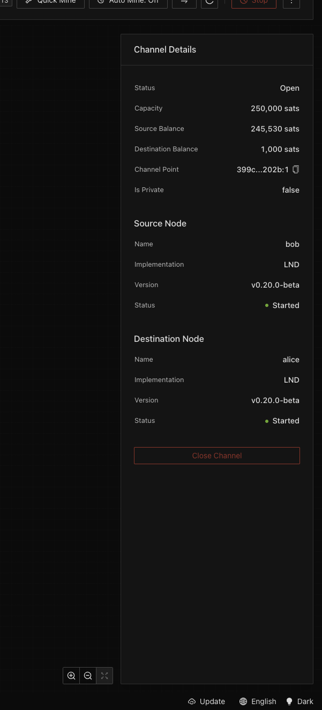
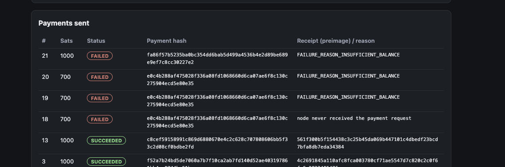
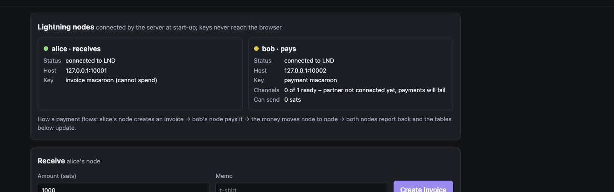
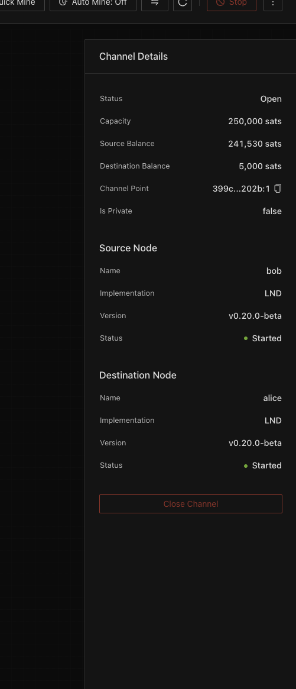

# Test report

Three kinds of test were run: failure tests by hand on real Lightning nodes, a load test of the API, and the automatic checks in CI. This page says what was done, what happened, and what it does not cover.

## The cases the design had to survive

These were written down before any code, as questions of the form "what happens if…":

| Case | What must happen |
|---|---|
| the same payment is requested twice, or many times at once | exactly one payment |
| the call to the paying node fails or gets no answer | the payment is "unknown", never "failed"; ask the node later |
| the service crashes after asking the node to pay | the record survives; the outcome is found after restart |
| the paying node is down | requests are still accepted and held; nothing is guessed |
| the receiver is paid while the service is down | the payment is recorded after restart |
| an invoice is never paid | it is marked expired |
| an operator must stop payouts | one switch, obeyed everywhere, surviving restarts |
| someone sends rubbish, an oversized amount, or uses the wrong account | refused before any record or node call |
| a failed payment is retried | allowed; a live or succeeded one is not |

## 1. Failure tests, run by hand

Run on 11–12 November 2026 on a local regtest network (Polar: Bitcoin Core 30.0, two LND 0.20.0 nodes, one 250,000-sat channel from bob to alice), through the web page.

| # | What was done | What happened | Rule it proves |
|---|---|---|---|
| 0 | Created a 1,000-sat invoice on alice and paid it from bob through the service | Payment `SUCCEEDED` with a preimage; invoice `PAID`. SHA-256 of the preimage equals the payment hash | the happy path; the preimage is the receipt |
| A | Paid the same invoice a second time | Refused: "this invoice is already being paid or was paid". No second row | the database allows one live payment per payment hash |
| A2 | Sent the same pay request 20 times in parallel (scripted, against a test database) | 1 accepted (202), 19 refused (409), one row | insert and let the unique index decide; no check-then-insert |
| B | Stopped bob's node, then asked to pay | Request accepted; row stayed `IN_FLIGHT`, not `FAILED`. After bob returned, the tracker asked the node, got "not found", and closed the row as `FAILED: node never received the payment request` | an error from the node call means unknown; only the node's answer closes a payment |
| B2 | Retried the same invoice after the failure | A new attempt was allowed (not "already being paid") | a failed payment may be retried; a live or succeeded one may not |
| C | Paused payouts, tried to pay, resumed, paid; paused again and restarted the service | Refused while paused; creating invoices still worked; same invoice paid after resume; still paused after restart | the pause switch is a database row checked before anything is saved |
| D | Stopped the service, paid alice's invoice directly from bob in Polar, started the service | Invoice turned `PAID` after start-up, with the time it was actually paid | the listener resumes from its saved settle index; no missed payments |
| E | Stopped bob, asked to pay (row `IN_FLIGHT`), killed the service with `kill -9`, restarted both | Row survived the kill; the tracker settled it as `FAILED` after start-up; a retry `SUCCEEDED` | the row is saved before the node is called; recovery needs only the database and the node |
| F | Pasted "hello" as an invoice; asked for a 200,000-sat invoice; pasted a genuine 150,000-sat invoice; signed in as alice and as bob | All three refused with a clear message and no row; alice has no pay action, bob has no receive action | input is checked first; "valid" and "allowed" are separate; each action names its roles |

Not run by hand: invoice expiry (needs an hour of waiting).

### Screenshots

The first payment between the two nodes, seen in Polar: 1,000 sats moved from bob's side of the channel to alice's.

Test B and the retries. Row 18 is the payment made while bob's node was down: it was held, then closed with the node's own answer. Rows 19–21 are retries that the node refused (see the incident below). Earlier rows show successful payments with their preimages.

The health check that explained those refusals: the service can reach bob's node, but none of its channels is usable.

Polar at the same moment: the channel is open and funded. "Open" is not "usable".

## An incident found while testing

After bob's node was restarted in test B, retries failed with `FAILURE_REASON_INSUFFICIENT_BALANCE` although the channel held about 241,000 sats on bob's side.

How it was found:

1. Polar showed the channel as open with funds, so the money was not the problem.
2. A health check was added to the service: how many of the paying node's channels are *active*. It showed "0 of 1 ready".
3. On the node itself, `lncli connect` answered "server is still in the process of starting".
4. Cause: at start-up LND waits until it is synced to the chain, and it treats a chain whose newest block is hours old as not synced. On regtest no block had been mined since the day before.
5. Fix: mine one block. The node finished starting, reconnected to its peer, the channel became active and payments succeeded. Auto-mining prevents it.

Two earlier guesses were wrong (the channel only needed a minute; the peer's address had changed). The node's own error message settled it.

What the service did during the incident: every attempt ended with the node's own answer, nothing was left stuck, nothing was paid twice, and each failed attempt could be retried.

Lesson: a node that answers RPC calls is not necessarily able to pay. Readiness has to be checked at the channel level, which the node panel now does.

## 2. Load test of the API

Tool: `cmd/loadtest`. It signs in as the payer, builds its own signed regtest invoices, and posts them to `POST /api/payments`.

Setup: one copy of the service and PostgreSQL 16 on the same 6-core machine, default settings (database pool of 6 connections). No Lightning node was connected, so this measures the **accept path** only: session check, pause check, invoice decode and signature check, database insert. It does not measure Lightning payments.

| Run | Requests | At once | Result | Per second | p50 | p95 | p99 |
|---|---|---|---|---|---|---|---|
| unique invoices | 2,000 | 50 | 2,000 × 202 | 1,150 | 36 ms | 72 ms | 95 ms |
| unique invoices | 5,000 | 200 | 5,000 × 202 | 1,106 | 174 ms | 243 ms | 282 ms |
| the **same** invoice | 1,000 | 100 | 1 × 202, 999 × 409 | 1,091 | 90 ms | 114 ms | 131 ms |

Checked in the database afterwards: 7,001 rows, 7,001 distinct payment hashes, 0 live duplicates. No connection errors, no error-level log lines, clean shutdown.

What the numbers say:

- **Throughput stayed at about 1,100 requests per second** whether 50 or 200 were sent at once, while response time grew about fivefold. That is the shape of a queue in front of a fixed-size resource: here the 6 database connections, with three queries and one disk-synced commit per request.
- **The duplicate storm produced exactly one payment** out of 1,000 attempts, with no locking in application code.
- The accept path is not the limit of the system. A single LND node pays through its own channels and is far slower than 1,100 per second, so in production the queue of `PENDING` rows would grow first. The alert on the age of the oldest unfinished payment exists for that.

What would raise the ceiling, in order: a larger database pool, caching the pause switch for a second instead of reading it per request, more copies of the API (it keeps no state), then more paying nodes.

Not tested: sustained load over hours, load with real nodes paying, behaviour when the database is slow or full.

## 3. Automatic checks (CI)

Every push runs: build and unit tests with the race detector; static analysis of our code (`staticcheck`, `gosec`); a scan of dependencies for known vulnerabilities (`govulncheck`); a scan of the history for committed secrets (`gitleaks`).

Found and fixed by static analysis so far: unhandled errors when writing responses; a possible integer overflow when converting an invoice amount. The dependency scan currently reports outdated libraries that still need upgrading.
